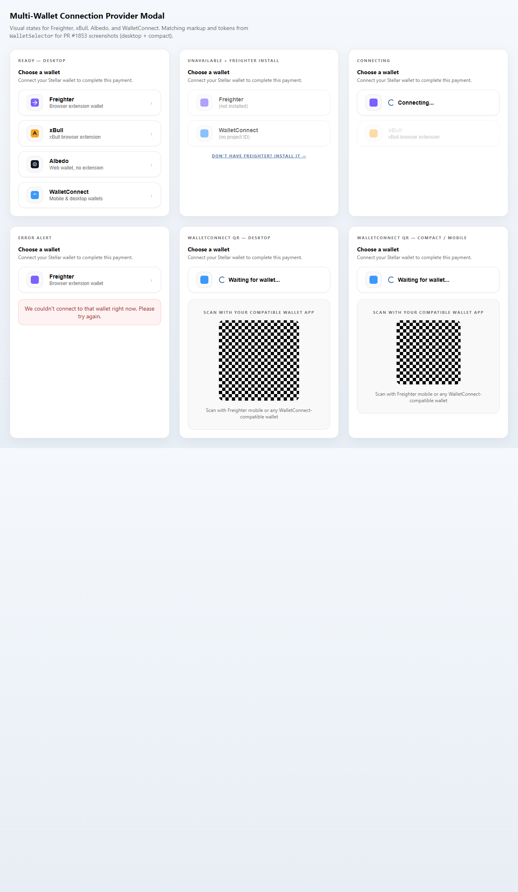
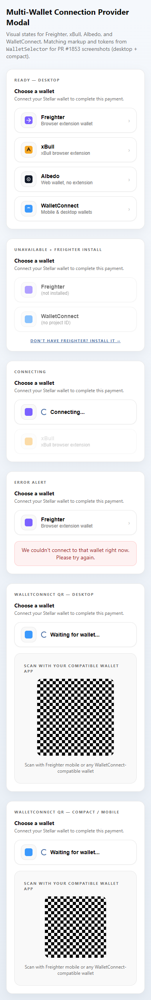
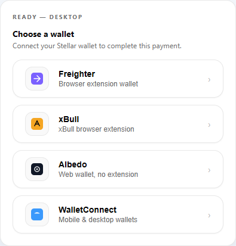
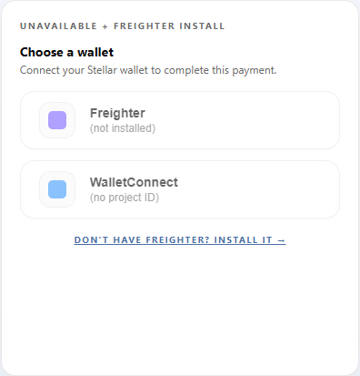
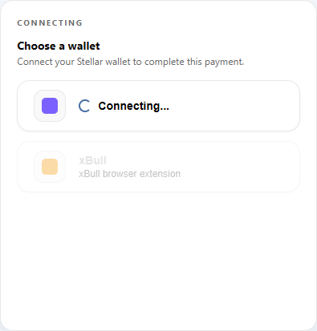
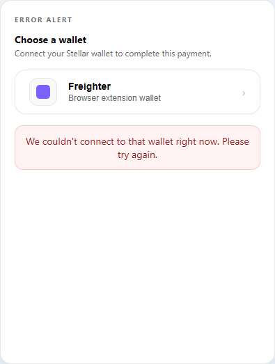
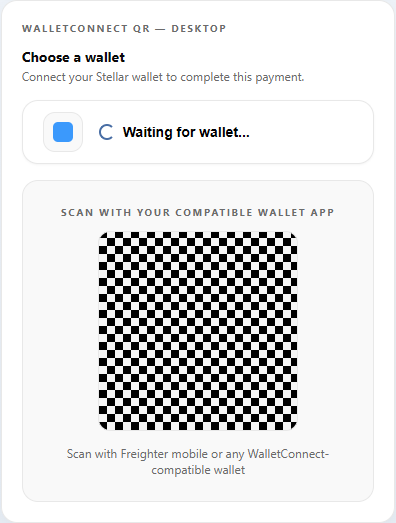
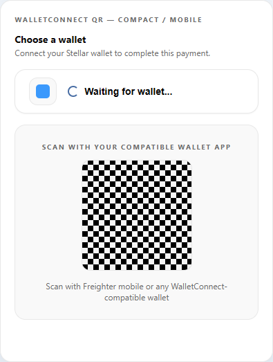

# Multi-Wallet Connection Provider Modal (#1853)

Checkout and payment detail render `WalletSelector` as an inline multi-wallet panel (Freighter, xBull, Albedo, WalletConnect). It is not a separate focus-trapping dialog.

## Screenshots

### Desktop gallery



### Mobile gallery



| State | Image |
| --- | --- |
| Ready (Freighter, xBull, Albedo, WalletConnect) |  |
| Unavailable + Freighter install link |  |
| Connecting |  |
| Localized error |  |
| WalletConnect QR (desktop) |  |
| WalletConnect QR (compact / mobile) |  |

Static gallery source: [`preview.html`](./preview.html) (same tokens and structure as `WalletSelector`).

## Coverage

| Area | Where |
| --- | --- |
| Snapshot + interaction suite | `frontend/src/components/WalletSelector.test.tsx` (63 tests) |
| Visual snapshots | `frontend/src/components/__snapshots__/WalletSelector.test.tsx.snap` |
| Live UI screenshots (desktop / mobile) | images in this folder |
| Accessibility | axe-core in the unit suite (WCAG 2.1 AA markup/ARIA; color-contrast skipped in jsdom) |

## States locked by tests

- Checking availability
- Ready (all providers)
- Unavailable + Freighter install link
- Connecting
- Localized error (raw wallet errors never echoed)
- WalletConnect QR (desktop + compact)
- Already connected (renders nothing)

## Security notes

- Pairing URIs are never rendered as text.
- Provider failures map to localized copy only.
- Network drop rolls back an in-progress choice and shows a toast without the raw error.
- Freighter install opens `https://freighter.app` with `rel="noopener noreferrer"`.

## Manual checks completed for this PR

- [x] Desktop gallery reviewed (ready, unavailable, connecting, error, QR)
- [x] Mobile / compact gallery reviewed (full-width panel + compact QR at 390px)
- [x] Interaction suite covers Tab / Arrow / Home / End, Freighter + WalletConnect happy paths, and error mapping
- [ ] Live Freighter extension approval in a personal browser (requires installed extension)
- [ ] Live WalletConnect pairing with a phone wallet (requires project ID + mobile wallet)

## Regenerating screenshots

```bash
python -m http.server 8765 --directory docs/wallet-selector-1853
# other terminal, from repo root:
node frontend/scripts/capture-wallet-selector-screenshots.mjs
```
